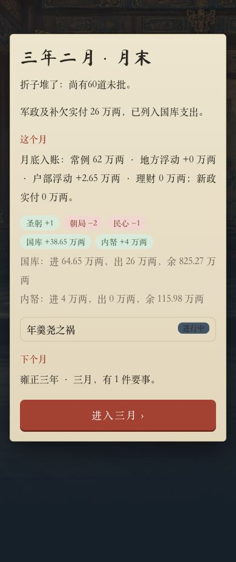
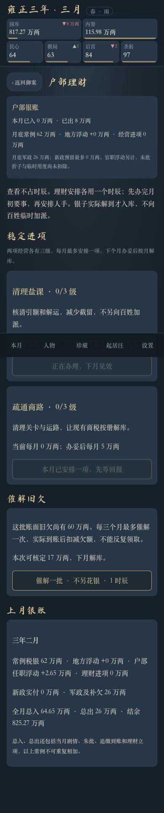
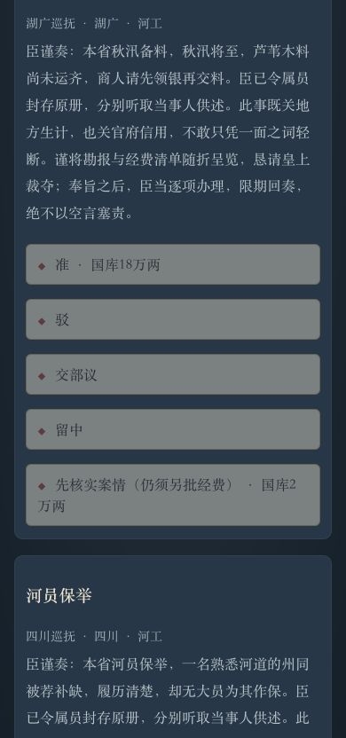
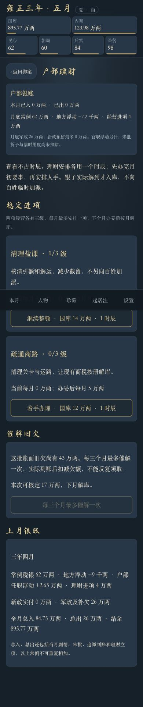
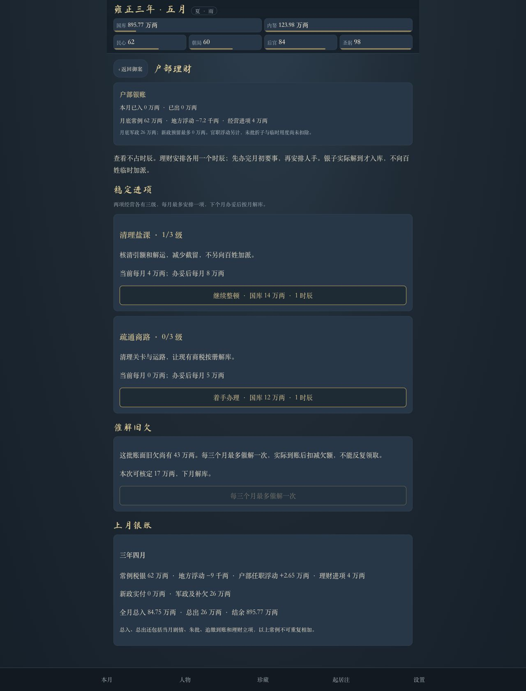

# 0.43.2 国库收支与折子减负验收

验收日期：2026-10-31。发布授权：玩家已确认“发布”。本文记录0.43.2发布前的本地测试和浏览器验收。

## 这次解决什么

玩家截图为雍正三年二月：国库786.62万两、内帑111.98万两、民心65、朝局64、后宫86、圣躬96，三个时辰已用完，首页显示60道折子。

截图的国库“▼46万两”是本月至今的变化，不能据此认定整月净亏46万两。常例税银原本在月底结算，但首页缺乏说明；普通折子每月3—5道，一时辰只批3道，钱粮和吏治也几乎只有支出，导致准奏较多的玩法负担明显。

本次保留原有常例收入、军政支出、地方和新政机制、盛世结局门槛；调整普通折子的负担，并增加可安排、可查账的进项。旧档读入不会直接增加银子，原折与已排期朱批仍保留。

## 玩家能看到的变化

- 首页新增“户部银账”和免费查看的“理财与收支”。已收入、已支出与月底预计收入分开；官职浮动、未批折子和临时用度另有说明。
- 普通新折每月2—3道，急灾仍另外发生。一时辰通常批6道，设值房后批10道。
- 办结回报自动收存，正在查勘的原折单独计数，不再作为“未批积压”扣分；正文和排期保留。交部议仍会带原折回来，不等于办结。
- 文教准奏12→10万两，民情8→6，钱粮及吏治6→3，刑名4→2。河工、赈灾、边务仍18万两，核查仍2万两。
- 指定清欠奏折新增“核清并追缴”：核实成功、实际解送后才入库，钱粮12万两、吏治10万两。失败、仅派员核查及不属于清欠的折子不会产生这笔收入。新版以前已安排的回报仍按旧规则兑现。

## 户部经营

| 项目 | 第一级成本／月入 | 第二级成本／月入 | 第三级成本／月入 |
| --- | --- | --- | --- |
| 清理盐课 | 8／4万两 | 14／8万两 | 20／12万两 |
| 疏通商路 | 12／5万两 | 20／10万两 | 28／16万两 |

每次立项占一个时辰，每月最多安排一个经营项目；下月办妥，再于该月底结算收益。升级收益替代旧级，两项合计最高每月28万两，不会重复叠加。

“催解旧欠”是另外一项行动：用一个时辰，不额外花银，次月实收；每三个月最多一次。待核账面总额60万两，实际到账后扣减，无法无限领取。额度为游戏参数，不是读档补贴，也不补发历史收入。

## 存档兼容

沿用存档版本2和原保存键，在新档及读档时补齐可选的 `s.fiscal`，不重建游戏、不覆写现有关系、生育、皇嗣、奏折或已排期事项。

新增字段：

- `projects.salt / projects.trade`：`level`、待办 `pending:{level,due}`；月份以连续游戏月序号记录。
- `arrearsPool`：尚待核收的旧欠总额，默认60；不是现金。
- `lastCollection`、`collectionPending:{amount,due}`：催欠间隔及在途银子。
- `investedAt`、`openedAt`、`settledAt`：当月经营限额、开月实收与经营收益防重复标记。
- `collectedThisMonth`：当月催欠实收。
- `lastReport`：上月年、月、常例、地方、官职、经营、新政实付、军政实付、真实收支账本及结余。

新增朱批排期使用 `ruleVersion:3` 与 `recoverable` 标记；原有旧版排期不追溯派发新收入。

## 自动验收

`npm test`：146项全部通过，0失败。包含原有136项回归和新增10项财务测试。原有测试中关于每月折数、批阅上限的预期按新规则更新，并补足8道原折验证6道上限；原有国库区间断言及其他验收条件没有放宽。

新增测试覆盖：旧档无补发且数据保留；立项扣款和时辰、延后生效、同月限制；升级不叠加和失败原子性；有限催欠及冷却、读档不重领；查实追缴、失败和非清欠不入账；旧朱批兼容；回报/查勘与积压分开；只读预算、真实现金守恒；截图压力样本恢复；普通及经营六年路线。

构建随发布回归测试通过，`_site/version.json` 为0.43.2，包含新增 `fiscal.js`；验收辅助页和测试数据不进入发布包。

### 相同旧脚本的前后对比

使用未修改的 `scripts/v041-balance.mjs`，6种策略各30组，同样种子 `41000+i*97`、各走72个月。下表为六年末国库中位数，单位万两。这组脚本不调用新增户部经营，因此可用来比较折子调整本身。

| 策略 | 0.43.1 | 本地0.43.2 |
| --- | ---: | ---: |
| 固定判断 | 1955.84 | 2242.59 |
| 先查后批 | 1669.57 | 2049.94 |
| 偏向准奏 | 581.55 | 1577.06 |
| 随机判断 | 1765.59 | 2023.32 |
| 随机并管理官员新政 | 2087.10 | 2419.88 |
| 节用判断 | 2112.75 | 2336.32 |

### 新增实际月结压力模拟

运行 `node scripts/v0432-balance.mjs`，每条路线30组，种子 `43200+i*97`。每月最多用一时辰批折，余下时辰安排经营或休养；使用引擎真实剧情、朱批、跨卷、月结和到账。现金核对包括跨月开启时已入库的追缴款。

| 路线 | 月数 | 末期国库范围／中位数 | 全程最低国库的最小值 | 末期待批 |
| --- | ---: | --- | ---: | --- |
| 新档，不使用新增经营 | 72 | 1264.71—1660.84／1487.70 | 704.50 | 0 |
| 新档，持续安排经营 | 72 | 3073.71—3469.84／3296.70 | 685.88 | 0 |
| 截图同等压力旧档 | 24 | 909.91—1128.02／1020.42 | 550.29 | 2—4 |

90组均无军政欠款，累计实际收支与最终余额核对误差均为0。截图压力样本在19—22个月首次降至不超过3道待批，中位数21个月；没有自动清空旧折。

**范围说明：未取得玩家真实存档。压力样本只复现截图可见日期、资源、零时辰和60道积压，其余官员、新政、具体折子等使用测试默认值。上述结果不是对真实玩家档案的恢复承诺。两张表的策略也不同，不应交叉作前后比较。**

## 浏览器验收与截图

通过 Codex In-app Browser 访问独立的 `http://127.0.0.1:8765`。使用本地隔离样本，没有读取或改写线上玩家存档；验收后恢复该测试端口原保存值、重置视口、关闭临时标签页和服务器。

1. 390像素手机视口载入零时辰旧档：国库仍786.62，内帑仍111.98；可免费查看理财，经营与催欠按钮禁用，无读档赠银。
2. 正常入夜独寝并月结：常例62、官职浮动2.65、军政26，实际净入38.65，结余825.27，账本一致。
3. 处理测试剧情后立项盐课：扣8万两、用一时辰，余额817.27；当月经营收入仍0，商路按钮提示当月已安排一项。
4. 催欠17万两：即时不增银，再用一时辰。剩下一时辰连续批六道，待批64→58，第七道禁用。
5. 测试辅助页调用正常引擎结算两个月并处理测试剧情：盐课一级生效、下一个月末实收4；催欠池60→43且处于冷却。三年四月全月总入84.75、总出26、月末895.77，含当月开月入库17；明细常例62、地方-0.90、官职2.65、经营4，合计67.75，另加催欠17。
6. 390像素手机和1280像素桌面均无横向溢出，已加载图片无破图，控制台无警告或错误。未在实体手机上验收。

## 改动文件

- `src/v2/fiscal.js`：经营、催欠、预算及旧档默认值。
- `src/v2/engine.js`：开月、月结、存读档和理财行动接入。
- `src/v2/government.js`：折子数量、批阅上限、分类费用、查实追缴、回报收存及待批计数。
- `src/v2/main.js`、`src/v2/v2.css`：首页银账、理财页、折匣提示和月结明细。
- `package.json`：本地版本0.43.2。
- `tests/v2-v0432.test.mjs`、`tests/support/fiscal-fixture.mjs`：新增财务与压力样本测试。
- `tests/v2-v041.test.mjs`、`tests/v2.test.mjs`：新批阅规则对应回归预期。
- `tests/fiscal-browser.html`：仅本地使用的隔离验收入口。
- `scripts/v0432-balance.mjs`：可重跑的财务模拟。
- 本验收文档及6张截图。

现有 `.chk.mjs`、0.39及0.41执行提示等无关未跟踪文件未修改。
