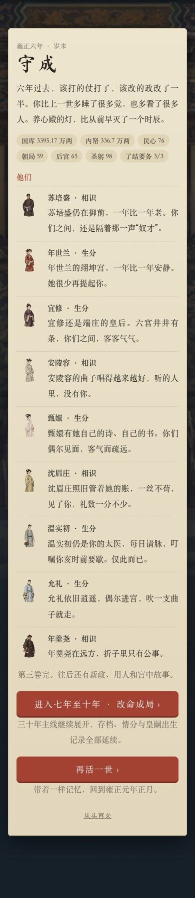
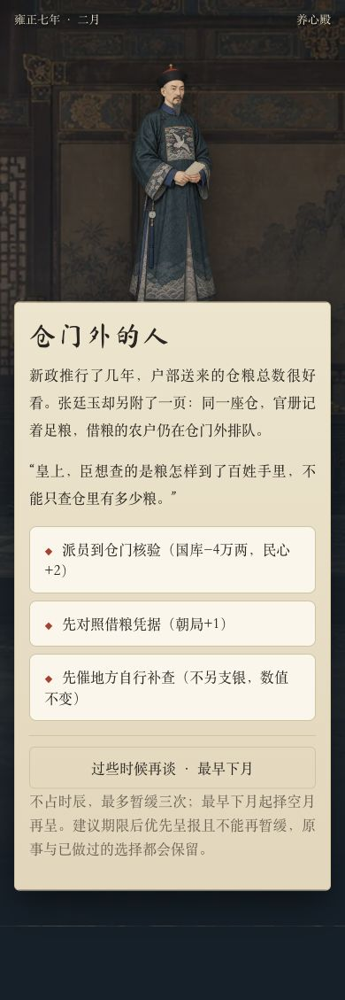
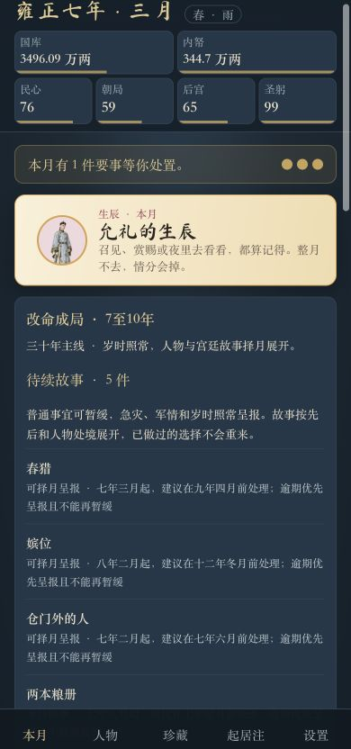
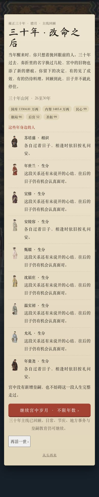
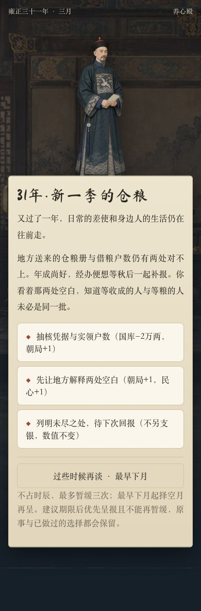
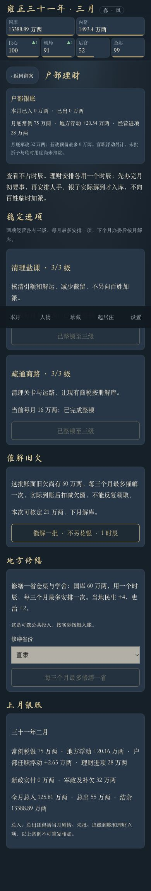
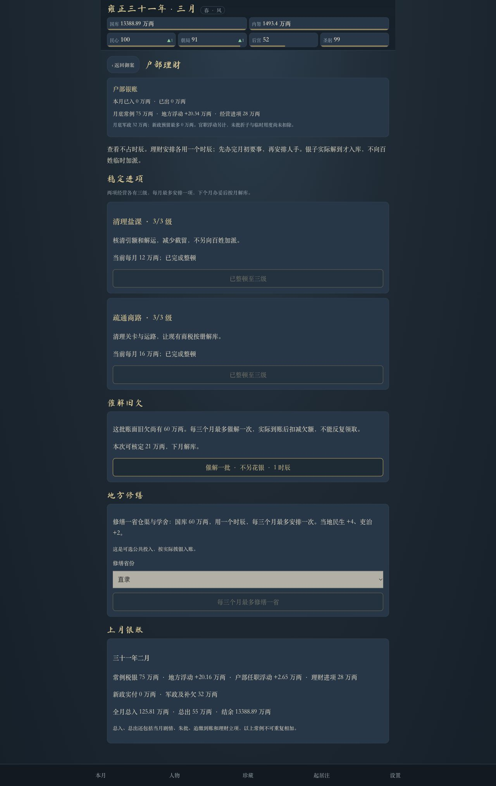

# 0.44 三十年主线与无限续玩验收

日期：2026-10-31。版本：0.44.0。已实现、测试与浏览器验收；玩家已确认push，本文记录本次推送前的验收结果。

## 玩家确认的范围

由原有六年流程扩展为三十年主线，之后无限续玩。固定岁时和重要年份节点保留，普通事件择空月呈报；旧档已完成的剧情不重播，孩子按真实出生月成长，不以生育作为完整路线的前提。

## 现在怎样玩

阶段回顾分别在二、四、六、十、十五、二十、二十五、三十年腊月。回顾后接续下一年，资源、人物关系、任官、新政、朱批排期与皇嗣出生记录都带过去。三十年以后不再因阶段末强制停止。

| 年份 | 篇章 | 内容重点 |
| --- | --- | --- |
| 元年至六年 | 原三卷 | 保留朝局大事、原有要务与历史选择 |
| 七至十年 | 改命成局 | 仓粮实效、用人交接、河工验收、十年旧札 |
| 十一至十五年 | 岁久见心 | 书房教育、宫中日常及治理成效 |
| 十六至二十年 | 承前启后 | 旧事续报、办事规矩、人物相处 |
| 二十一至二十五年 | 薪火与人间 | 交接、再访、地方与家庭的回音 |
| 二十六至三十年 | 三十年山河 | 新人办事、家书、成败总录与三十年回望 |
| 三十一年以后 | 宫中岁月 | 每年继续岁时、日常政务、皇嗣教育与循环主题故事 |

七至三十年新增48张故事卡，每年两张，后半段读取前半段选择作为回音。每卡三选项，标明资源变化，至少一项不花银；资金不足时付费选择会被拒绝，不会暗中把欠款抹掉或产生半次结算。没有皇嗣时，教育题仍有宗学和书房教习的完整分支。

三十一年后每年生成两张独立年份ID的故事，七种主题轮替，后续读取本年或上一年选择。这里是可持续的主题变化，不声称三十年后每一张都是全新手写故事。元年到三十年的48张主卡不会反复重播。

## 事件排期与暂缓

新增独立时间线，普通事件只在当前没有要事时安排一张；重大政务的在途回报、岁时、急灾与家庭历法事项仍可及时加入。原固定剧情链仍有多卡月，例如元年四月的新帝第一折与查亏空、二年五月的凯旋与军账链。这次不承诺所有月份都只有一件事。

普通事件依前事、人物处境与季节筛选。已排出的事件可以不占时辰暂缓，最早下月择空月再呈，最多主动暂缓三次；超过建议期限后不能再主动暂缓，会优先呈报。建议期限不是悄悄删卡的截止线，遇到岁时和急报仍保留后续。

| 例子 | 新排期 |
| --- | --- |
| 初见与人物引入 | 原节点之后留出数月，不再全部挤在大事同月 |
| 诬案的线头 | 四年二月起，建议八年六月前 |
| 协理六宫 | 五年二月起，建议九年十月前 |
| 流言 | 六年三月起，建议十年八月前 |
| 春猎 | 七年三月起，春季择月，建议九年四月前 |
| 嫔位 | 八年二月起，建议十二年冬月前 |
| 香 | 九年三月起，建议十四年十月前 |
| 行乐图 | 十年九月起，建议十五年十月前 |

七夕、两场生辰、时疫以及原M/V/W大事仍在原有固定表中；诞育和十岁换图不进入普通延期名单。第四、第五幕与上一幕至少间隔三个月；已完成的关系阶段不回退。

## 长期经营与安全

- 六年前的资源结算保持原规则。七年起圣躬常态每月减1，后宫自然损耗改为每半年减1，避免把短流程损耗无限累加。仍需自行照顾身体和关系，并非所有数值自动稳定。
- 七年起可选择地方修缮：一个时辰、国库60万两，每三个月最多一省；当地民生+4、吏治+2，上限100。先校验资金、时辰、地区与冷却，再实际扣款；无新增强制税费，不改写旧现金。
- 常例、盐课、商路和新政继续按原经济档位结算。长期储银仍可能积累，现金没有硬封顶；公共工程是有用途的可选投入，不能理解为所有玩法都会保持同一国库区间。
- 去掉“回报达到120条即永久停发大型事件”的错误门槛，回报仍滚动保存。
- 所有皇嗣永久按未成年人保护。真实年龄可以超过十八岁，但不开放恋爱、婚配、亲密或性相关安排，也不因长篇解锁成人分支。AI仍收到真实年龄及“未成年”标注。
- AI日期上下文明确这是架空改命时间线，不能因史实年份擅自写人物死亡、继位或皇嗣成年。新增内容不作真实史实纪年承诺。

## 旧档怎样接入

保持保存键和存档版本2，补齐可选 `s.campaign`。旧版六年结局可直接接入七年；已在七年以后的家庭档接入当前阶段。读档不改现金、年月、人物、选择、奏折、孩子、孕期和当月待办。

旧档在采用新版排期时，已经错过起始时点且未进入当月待办的旧故事不追播；后续若依赖一个已错过的前篇，也一并退出，不伪造前篇完成、更不永久挂着“等待前事”。当月已经在眼前的旧卡照常处理。已经完成的故事不会重新进入候选。

新增存档字段：

- `campaign.version`：时间线结构版本1，和原存档版本独立。
- `campaign.adoptedAt`：接入新版排期的游戏月序号。
- `campaign.skipped`：旧档不追播及依赖传递排除的事件ID。
- `campaign.deferred[id] = {count,until}`：主动暂缓次数和最早重呈月份。
- `campaign.shown[id]`：最近呈报月份。
- `campaign.openYears`：三十一年后已经开启的故事年份，使未办完的故事跨年仍能找到。
- `fiscal.lastWorksAt`：地方修缮冷却月份，仅实际安排后写入。

没有用 `vol=4` 直接索引旧的三档收入或结局。七年后仍用原第三档经济参数，章节和回顾独立计算，防止出现 `undefined` 或无效金额。

## 自动测试与长程模拟

最终 `npm test`：155项全部通过，0失败，0跳过。原有146项未修改；新增9项覆盖排期、迁移、依赖、暂缓、皇嗣安全、公共工程、事件循环及真实长程推进。

通过引擎逐月走满三十年，多种子验证48张新卡各发生一次、前置顺序正确；继续到四十年，验证没有强制二次解锁、跳月、无效金额。另验证O31B暂缓后跨过年节、存读档，在三十二年仍可呈报并办结。

孕期到期、十岁换图和出生月生辰的旧测试继续通过；新增测试同时确认到期家庭卡不能暂缓，三十岁皇嗣仍被亲密计划排除。迁移用例核对原档字段，不以重新开局代替兼容。

运行 `node scripts/v044-balance.mjs`，共10个种子：其中8组走360个月，2组继续走480个月。使用正常剧情选择、真实朱批及月结；每月只用一个时辰批折，另安排经营、季度自愿修缮及休养，没有把资源调满或跳月。

| 指标 | 8组×三十年 | 2组×四十年 |
| --- | --- | --- |
| 期末国库（万两） | 12148.92—14824.10 | 19115.19—19115.55 |
| 月中最低国库（万两） | 704.41—765.00 | 743.77—769.65 |
| 最低圣躬 | 67—69 | 67—69 |
| 最低后宫 | 43 | 34 |
| 地方修缮次数／组 | 96 | 136 |
| 军政欠款月份 | 0 | 0 |
| 累计现金核对误差 | 0 | 0 |

这些是批折、经营和休养路线的抽样结果，不是所有玩家选择的保证。此路线没有主动经营恋爱关系，人物情分会变淡，模拟没有掩盖这一点。长流程资金有积累，仍需后续根据实际玩家玩法观察；本次没有为了压低数字直接扣掉旧存款。

构建回归通过，发布包版本0.44.0，包含时间线与新故事模块；本地验收页、测试和样本不进入发布包。

## 浏览器验收

使用 Codex In-app Browser，在独立 `http://127.0.0.1:8766` 端口测试390像素手机视口及1280像素桌面。样本由元年新档正常逐月推进至对应年月后保存，不是改日期凑出的结局；不读取或写入在线玩家存档。

实走结果：

1. 六年结局出现“进入七年至十年”按钮；点击进入七年正月，保留资源与人物。样本当月开月追缴12万两来自原先已付费朱批回报，按账本实际入库，不是迁移赠银。
2. 七年二月“仓门外的人”有三选项、明确代价及暂缓按钮。暂缓后仍有三个时辰，国库3421.54万两不变；正常独寝、月结进入三月，原事重新呈报。
3. 待续册显示中文日期和“等待前事”，将未到起始月份的事项标为“尚未到时”。
4. 三十年回顾显示真实年份、资源、关系和无限继续按钮。点击后进入三十一年正月，未强制死亡、继位或重开。
5. 三十一年三月仍有新年度仓粮事件，实际选择并结算了免费选项；理财页显示地方修缮用途和季度冷却。
6. 手机和桌面无横向溢出；已加载图片无破图，页面控制台无警告或错误。没有实体手机验收，也没有实际调用付费AI。

验收后恢复该测试端口的存档、AI开关及年龄确认值，重置视口，关闭临时标签页和服务器。

## 改动文件

新增 `src/v2/timeline.js`、`src/v2/long-stories.js`、`scripts/v044-balance.mjs`、`tests/v2-v044.test.mjs`、`tests/longgame-browser.html` 及本验收文档和七张截图。

修改 `src/v2/engine.js`、`main.js`、`v2.css`、`fiscal.js`、`major-events.js`、`ai.js`、`data.js` 和 `package.json`。原有无关未跟踪文件未修改。
